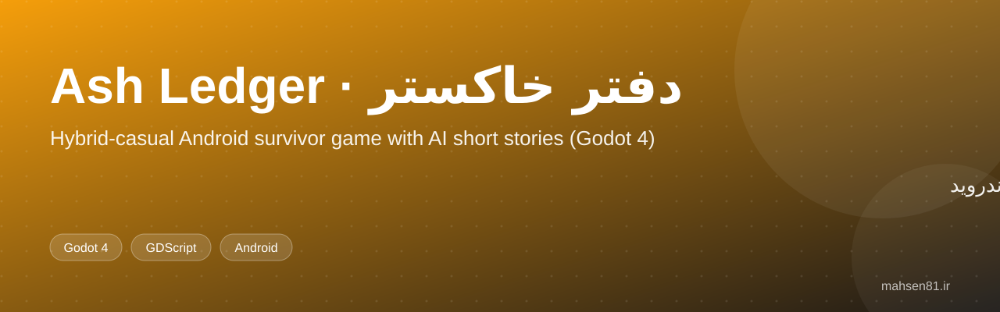

<!-- gen:header -->
<p align="center"></p>

<h1 align="center">Ash Ledger · دفتر خاکستر</h1>
<p align="center"><b>بازی بقا با داستان‌های کوتاه هوش مصنوعی برای اندروید</b><br><i>Hybrid-casual Android survivor game with AI short stories (Godot 4)</i></p>
<p align="center">  </p>

<div dir="rtl">

## ✨ امکانات

- حلقه‌ی بقا با موج دشمن و باس
- ۵ فصل داستانی
- رابط فارسی و جوی‌استیک لمسی
- بازی دوم: روپایی پرو برای وب و موبایل

</div>

## 🚀 Quick start

```bash
Open project.godot in Godot 4.7+ → Run
```

---

<!-- gen:docs -->
## 📚 مستندات کامل · Full documentation

# دفتر خاکستر (Ash Ledger)

بازی hybridcasual اندروید: **بقا (Survivor)** + **داستان کوتاه AI** + متای سبک.

## MVP آماده‌ی اجرا

- حلقهٔ بقا: حرکت، شلیک خودکار، XP، ارتقا، موج دشمن، boss
- ۵ فصل JSON در `content/story/` + پرامپت AI در `content/prompts/`
- هاب با ۳ ارتقای دائمی (جان / آسیب / حلقهٔ اخگر) و ذخیرهٔ محلی
- رابط فارسی RTL، پالت خاکستر+کهربایی، جوی‌استیک لمسی، portrait

## اجرا (Godot 4.7+)

1. پروژه را در Godot باز کن (`project.godot`)
2. `F5` بزن
3. **تک‌نفره** → هاب → **بقا** روی فصل باز

### کنترل

- کیبورد: WASD / فلش‌ها
- لمس: جوی‌استیک گوشه

## جریان بازی

منو → هاب → ران survivor → (برد) خواندن فصل → آنلاک فصل بعد → متا با خاکستر

## داستان با AI

پرامپت: [`content/prompts/chapter_generator.md`](content/prompts/chapter_generator.md)  
فایل‌ها: `content/story/chapter_XX.json` + افزودن id به `GameState.CHAPTER_ORDER`

## خروجی اندروید

Preset در `export_presets.cfg` (پکیج `com.ashledger.game`).  
راهنما: [`export/ANDROID.md`](export/ANDROID.md)

```bat
godot --headless --path . --export-debug "Android" export/AshLedger-debug.apk
```

نیاز: Export Templates نسخهٔ 4.7.stable + Android SDK + JDK.

## دموی وب سریع

[`export/demo/ash-ledger-demo.html`](export/demo/ash-ledger-demo.html)

---

<p align="center">ساخته‌شده توسط <a href="https://mahsen81.ir"><b>محسن جباره‌اصل</b></a> — برنامه‌نویسی، طراحی سایت، ربات و هوش مصنوعی<br>
Built by <a href="https://mahsen81.ir">Mohsen Jabbareh-Asl</a> · ⭐ اگر مفید بود، ستاره بدهید · Need a custom version? <a href="https://mahsen81.ir">Get in touch</a></p>
